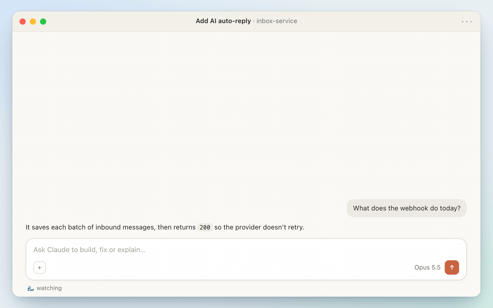
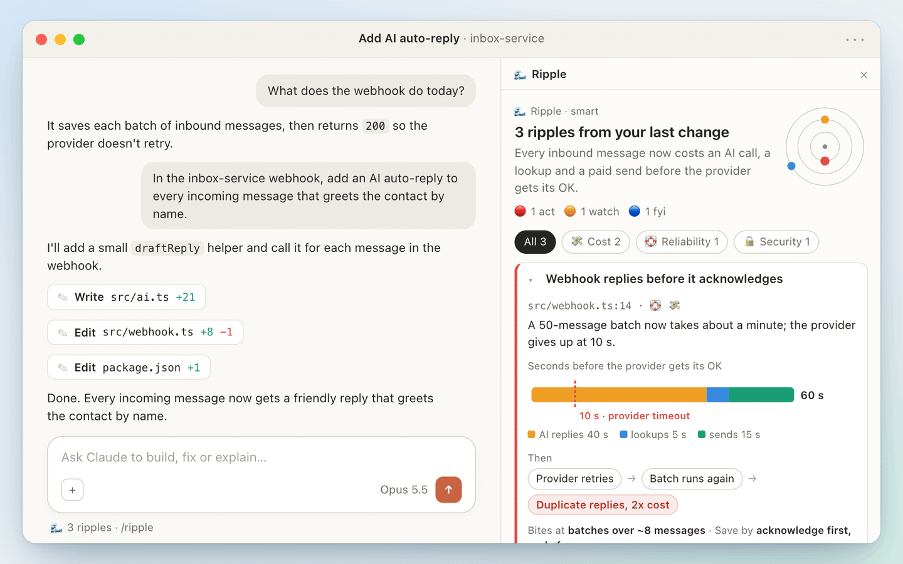
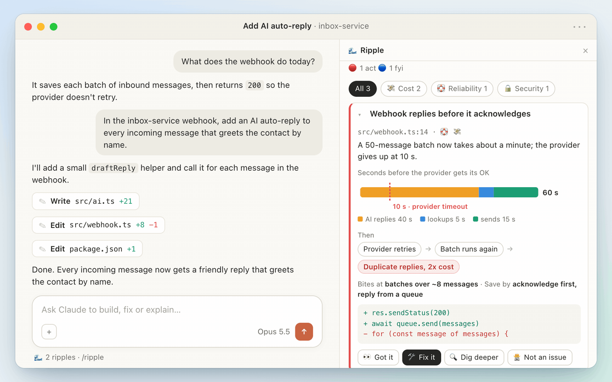
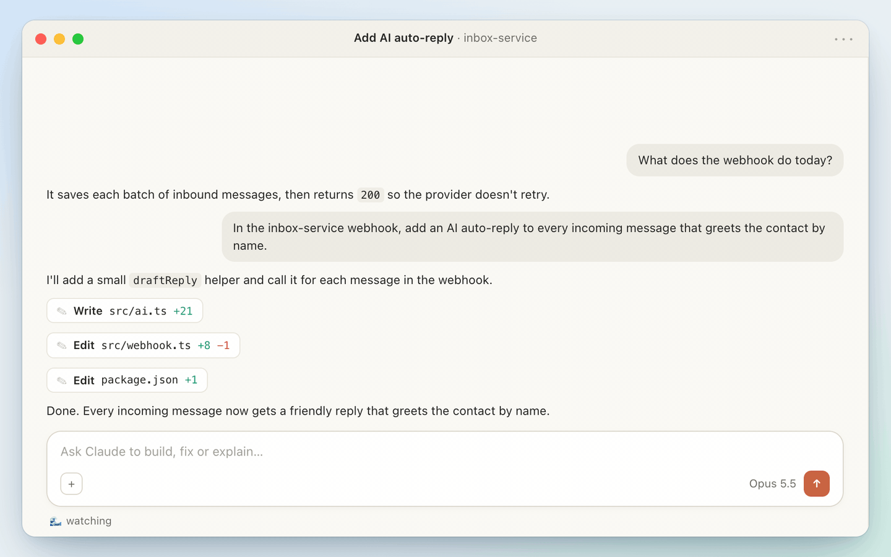

<p align="center">
  
</p>

<p align="center">
  <b>Claude just wrote 20 clean lines. They also put an Opus call, a retry storm and a paid send behind every message.</b><br>
  Ripple tells you in plain words as soon as the turn ends, before it ships.
</p>

<p align="center">
  
  
  
  
</p>



## What it watches

| 💸 Cost | 🔒 Security | 🛟 Reliability | ⚡ Efficiency | 📈 Scale | 🧩 Stack |
| :-: | :-: | :-: | :-: | :-: | :-: |
| per-request spend, LLM calls, paid APIs | secrets, PII in logs, injection | timeouts, retries, failure paths | N+1 queries, work inside loops | limits, fan-out, hot paths | dependencies, contracts, migrations |

Every finding says **what happens next**, **when it starts to bite** and **how to save**. When numbers help, it adds a chart.

## See it work

**Decide once, and the team remembers.** "Got it" is saved to `.ripple/ledger.json`. Commit that file and no teammate is asked about it again.



**Hand the fix back to Claude.** "Fix it" sends the finding to Claude, and Ripple reviews the fix too.



**Free when it's small, thorough when you ask.** Small, safe edits never call a model. `/ripple check` reviews everything uncommitted, and every review shows what it cost.



## Install

In a Claude Code terminal session:

```
/plugin install ripple --marketplace alshell7/ripple
```

Answer `y` to add the marketplace, then pick a scope.

**In the desktop app:** click **+** next to the prompt box, then **Plugins** → **Add marketplace** → `alshell7/ripple` → **Add plugin**.

<sub>This repository is private. Installing works for people who can read it on GitHub and already have a git credential for github.com: an SSH key, or `gh auth login` followed by `gh auth setup-git`.</sub>

## Commands

| Command | What it does |
| --- | --- |
| `/ripple` | open the pane |
| `/ripple check` | review everything uncommitted, including your own edits |
| `/ripple check main` | review this branch since it left `main` |
| `/ripple scale 40 msg/s peak, 1.5M contacts, RDS` | tell Ripple your scale, so cost estimates are grounded |
| `/ripple ledger` | list what the team already knows |
| `/ripple mode smart` · `always` · `manual` | choose when reviews run |

## Why it's cheap

- **0 tokens for small, safe edits, docs and tests.** A local scanner with about 45 rules decides whether a review is needed at all.
- **One short review per turn** on a lean model (`sonnet` by default). It gets a compact diff and a cached brief, and every field has a word limit. A review usually costs under a cent.
- **Nothing is added** to your conversation's context.

<details>
<summary><b>Settings</b></summary>

| key | default | |
| --- | --- | --- |
| `mode` | `smart` | `smart`, `always` or `manual` |
| `sensitivity` | `balanced` | `relaxed`, `balanced` or `eager`: how readily smart mode calls the reviewer |
| `reviewer` | `lean` | `lean` (cheap model, compact diff) or `session` (a fork of your conversation) |
| `reviewModel` | `sonnet` | the model for lean reviews and `/ripple check` (`haiku` is cheapest) |
| `ledgerPath` | `.ripple/ledger.json` | leave empty to keep the ledger private to you |
| `autoOpen` | `true` | open the pane when new ripples arrive |

</details>

<details>
<summary><b>How it works</b></summary>

1. **Each edit** is scanned locally (free) on the lines it adds, including new calls placed inside existing loops.
2. **When the turn ends**, smart mode decides whether a review is worth tokens: one risky signal, several small ones, or a large change.
3. **The reviewer** gets the compact diff, your last request, your scale and the scanner's hints. It returns at most 5 findings.
4. **The pane** shows one plain sentence, a radar of the findings and the top card open. A card has a chart, a "what happens next" chain and the fix as a diff.
5. **You decide**: 👀 Got it · 🛠 Fix it · 🔍 Dig deeper · 🙅 Not an issue. Decisions go to the ledger, so they aren't raised again.

</details>

<details>
<summary><b>Develop</b></summary>

```
claude --plugin-dir .            # run Ripple from this folder
claude plugin validate .
claude plugin test .
node docs/demo/src/render.mjs    # re-render the demo GIFs (needs Chrome and ffmpeg)
```

The hooks module is `hooks/register.tsx`, the scanner `hooks/signals.ts`, the reviewer's brief `hooks/review.ts` and the pane `hooks/pane.tsx`.

</details>

<p align="center"><sub>MIT © 2026 Owais Khan · made with 🌊 for teams who'd rather know first</sub></p>
